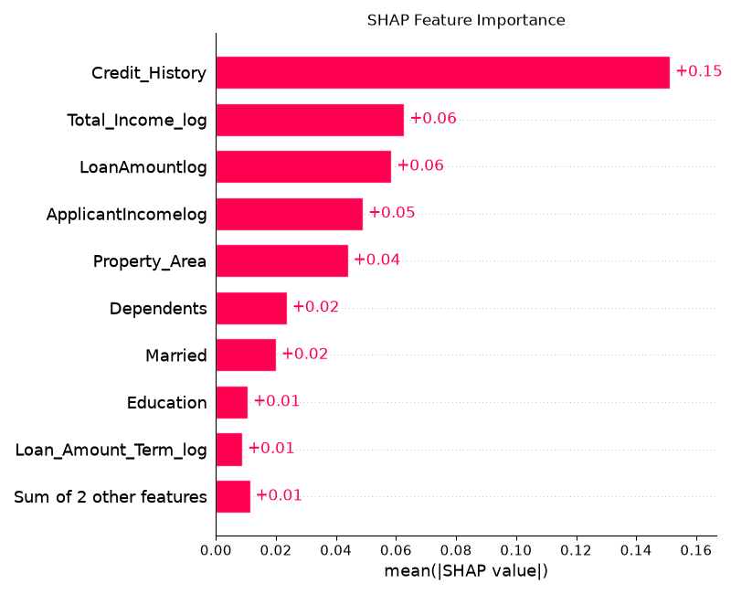
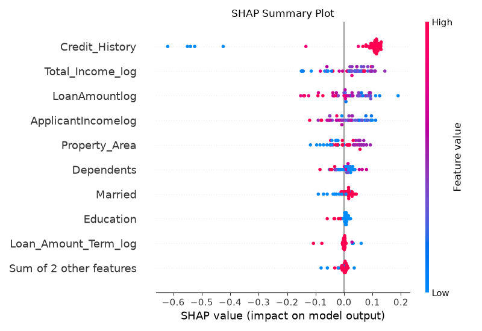
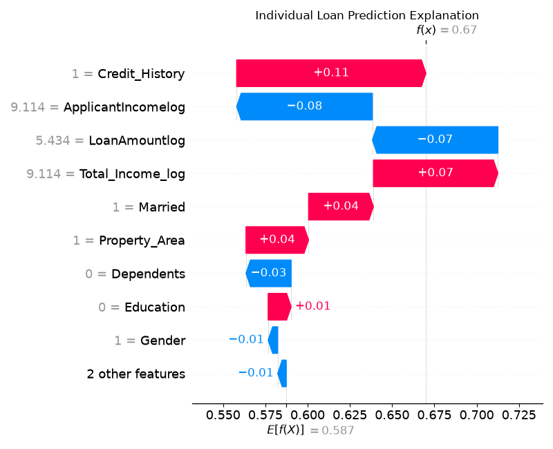

# Credit Risk Modelling Using Machine Learning

### An Explainable Machine Learning Approach to Loan Approval Prediction

## Project Overview

Credit Risk Modelling Using Machine Learning is a data science project developed to analyse loan applicant information and predict loan approval outcomes. The project applies data preprocessing, exploratory data analysis, feature engineering and machine learning classification techniques to identify patterns associated with loan approval.

Along with predictive modelling, the project incorporates **SHAP (SHapley Additive exPlanations)** to interpret model predictions and understand the contribution of individual features to the results.

## Project Objectives

- Analyse applicant and loan-related information to identify important factors influencing loan approval.
- Preprocess and transform the dataset to prepare it for machine learning.
- Develop and evaluate multiple classification models.
- Predict whether a loan application is likely to be approved or rejected.
- Use SHAP visualisations to improve the interpretability of model predictions.
- Provide an interactive prediction interface through a Streamlit application.

## Dataset

The project uses the loan approval dataset available in `Dataset.csv`.

The dataset contains applicant-related information, including:

- Gender
- Marital Status
- Dependents
- Education
- Self-Employment Status
- Applicant Income
- Co-applicant Income
- Loan Amount
- Loan Amount Term
- Credit History
- Property Area
- Loan Status

**Target Variable:** `Loan_Status`

- `Y` – Loan Approved
- `N` – Loan Rejected

The dataset is processed before model training to handle missing values, transform categorical variables and prepare suitable features.

## Methodology

The project follows a structured machine learning workflow:

1. **Data Collection:** Load and examine the loan approval dataset.
2. **Data Preprocessing:** Handle missing values, remove inconsistencies and encode categorical variables.
3. **Exploratory Data Analysis:** Study feature distributions, relationships and correlations.
4. **Feature Engineering:** Generate additional features, including total income and logarithmic transformations.
5. **Model Training:** Train classification models using the prepared dataset.
6. **Model Evaluation:** Assess model performance using classification metrics and confusion matrices.
7. **Explainable AI:** Apply SHAP to analyse feature importance and individual predictions.
8. **Prediction Interface:** Use a Streamlit application to accept applicant details and display prediction results.

## Machine Learning Algorithms

The project explores the following classification algorithms:

| Algorithm | Purpose |
|---|---|
| Logistic Regression | Predicts loan approval using a classification approach |
| Decision Tree | Uses decision rules to classify loan applications |
| Random Forest | Combines multiple decision trees to improve prediction |
| K-Nearest Neighbors (KNN) | Classifies applications based on neighbouring observations |

The models are evaluated using appropriate classification metrics, including accuracy, precision, recall and F1-score.

## Explainable AI Using SHAP

SHAP is integrated to explain how individual features influence the model's predictions.

The generated visualisations include:

**1. SHAP Feature Importance**

Shows the relative contribution of features to the model output. Credit History appears as the most influential feature in the generated feature-importance visualisation.

**2. SHAP Summary Plot**

Displays the distribution and direction of feature contributions across observations.

**3. SHAP Waterfall Plot**

Explains how individual feature contributions move a particular prediction away from the model's baseline output.

### SHAP Visualisation Results







## Application and Technologies

The repository contains both R-based analysis and a Python-based prediction application.

| Component | Technology |
|---|---|
| Data Analysis | R |
| Machine Learning Application | Python |
| Interactive Dashboard | Streamlit |
| Data Processing | Pandas, NumPy |
| Machine Learning | Scikit-learn |
| Model Explainability | SHAP |
| Visualisation | Matplotlib, Seaborn, R visualisation packages |
| Development Environment | VS Code / RStudio |

## Repository Structure

```text
Credit-Risk-Modeling-Using-Machine-Learning/
│
├── Dataset.csv
├── README.md
├── credit_risk_analysis.R
│
├── app.py
├── requirements.txt
├── test_shap.py
│
├── loan_model.pkl
├── feature_columns.pkl
│
├── shap_feature_importance.png
├── shap_summary.png
├── shap_waterfall.png
│
├── 24BDS1112_24BDS1071_PDS_REPORT_FINAL.pdf
├── Credit_Risk_Modeling_Presentation.pptx
└── Credit_Risk_Modeling_Presentation.pdf
```

## Running the Python Application

### Prerequisites

- Python installed on the system
- pip package manager
- Required packages listed in `requirements.txt`

### Installation

Clone the repository:

```bash
git clone https://github.com/Vasun0505/Credit-Risk-Modeling-Using-Machine-Learning.git
```

Move into the project directory:

```bash
cd Credit-Risk-Modeling-Using-Machine-Learning
```

Install the required dependencies:

```bash
pip install -r requirements.txt
```

Run the Streamlit application:

```bash
streamlit run app.py
```

The application will open in the browser, where applicant details can be entered to obtain a loan approval prediction.

### Running the R Analysis

Open `credit_risk_analysis.R` in RStudio or another R-compatible environment.

Ensure the required R packages are installed and that `Dataset.csv` is available in the project directory. Run the script to execute the data analysis and machine learning workflow.

## Project Documentation

The complete project report and presentation are available below:

- [Final Project Report (PDF)](24BDS1112_24BDS1071_PDS_REPORT_FINAL.pdf)
- [Project Presentation (PPTX)](Credit_Risk_Modeling_Presentation.pptx)
- [Project Presentation (PDF)](Credit_Risk_Modeling_Presentation.pdf)

## Conclusion

This project demonstrates the application of data science and machine learning techniques to loan approval prediction. By combining data analysis, multiple classification algorithms and SHAP-based explanations, it provides both predictive results and insights into the factors influencing those results.

The project also demonstrates how a trained machine learning model can be integrated into an interactive application, making the prediction process accessible through a user-friendly interface.

## Repository

**GitHub:** https://github.com/Vasun0505/Credit-Risk-Modeling-Using-Machine-Learning
